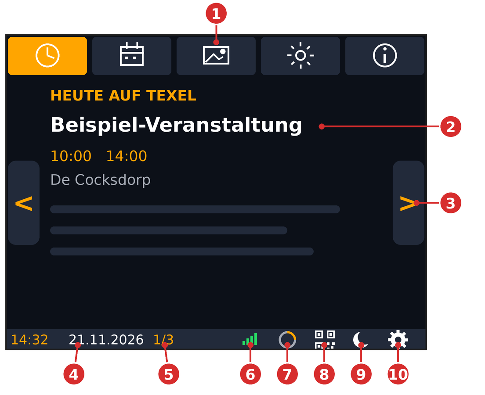
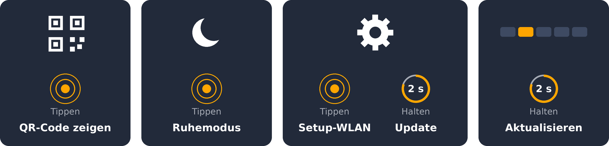

<!--
PDF erzeugen (A4, genau 2 Seiten), im Ordner docs/ (pandoc + Chrome/Chromium):

  pandoc kurzanleitung.md -s --embed-resources --css kurzanleitung.css \
    --metadata pagetitle="Kurzanleitung" -o kurzanleitung.html
  google-chrome --headless --no-pdf-header-footer \
    --print-to-pdf=kurzanleitung.pdf kurzanleitung.html

Alternativ jeder andere Markdown-zu-PDF-Konverter (z. B. die VS-Code-Erweiterung
"Markdown PDF"). Der Seitenumbruch zwischen Vorder- und Rückseite steht als

 mitten im Text. Die Bilder in img/ erzeugt tools/generate_quickstart_images.py.
-->

# Texel-Info-Display – Kurzanleitung

Das Display zeigt Veranstaltungen, den Belegungskalender, Fotos, Wetter und Gezeiten sowie die Haus-Infos. Bedient wird nur mit dem **Finger** auf dem Bildschirm – bei Bedarf etwas fester tippen.

**So geht's los:** Nach dem Einschalten erscheint ein Begrüßungsbild (**Tippen** schließt es sofort). Danach sehen Sie die Seite *Aktuell*. Ist der Bildschirm schwarz, ruht das Display – **einmal berühren** weckt es auf.

## Das Display im Überblick

{width=10.5cm}

| Nr. | Was | Bedeutung |
|:--:|:-------|:----------------------------------|
| 1 | **Reiter** | Bereich wählen: Aktuell (Uhr), Kalender, Fotos, Wetter (Sonne), Info (i). Der aktive Reiter ist orange. |
| 2 | **Inhalt** | Die gewählte Seite. |
| 3 | **Pfeile < >** | Im Bereich blättern. Die ganze linke bzw. rechte Kante ist Touch-Fläche. |
| 4 | **Uhrzeit / Datum** | Uhrzeit orange, Datum weiß. |
| 5 | **Seitenanzeige** | z. B. 1/3 = Seite 1 von 3 (bei Fotos: Foto-Nummer). |
| 6 | **WLAN** | Grün = gut, gelb = mittel, rot = schwach oder keine Verbindung. |
| 7 | **Kreis** | Läuft ab, bis das Display nach 60 Sekunden selbst weiterblättert. |
| 8–10 | **QR, Mond, Zahnrad** | Siehe Rückseite. |

## Die fünf Bereiche

| Reiter | Was Sie sehen | Bedienung |
|:--------|:----------------------------|:----------------------|
| **Aktuell** | Veranstaltungen auf Texel für heute und morgen, eine pro Seite, nach Uhrzeit sortiert | **< >** = nächste/vorige Veranstaltung |
| **Kalender** | Monatsübersicht der Haus-Belegung | **< >** = Monat zurück/vor; mit dem Finger **nach oben/unten wischen** = scrollen |
| **Fotos** | Ein zufälliges Foto von Texel mit Ort und Datum | **< >** = nächstes Foto (lädt kurz) |
| **Wetter** | 3 Seiten: *Jetzt*, die nächsten 5 Tage, Gezeiten (Hoch-/Niedrigwasser mit Verlauf) | **< >** blättern. Gezeiten sind Modellwerte, nicht für die Navigation geeignet |
| **Info** | Haus-Infos: Ankunft, Heizung, Gasherd, Internet, TV, Abreise u. v. m. – auch ohne Internet | **< >** blättern |

**Tipps:** Das Display blättert alle 60 Sekunden von selbst zur nächsten Seite; ein Tippen auf **< >** startet die Zeit neu, mit geöffnetem QR-Code bleibt die Seite stehen. Auf *Info → Internet* steht ein **QR-Code für das Gäste-WLAN**: mit der Handy-Kamera scannen und verbinden.

# Rückseite – Fußzeile, Einrichtung, Hilfe

## Die Symbole in der Fußzeile

{width=17cm}

| Symbol | Aktion | Wirkung |
|:--------|:-----------|:----------------------------------------|
| **QR-Code** | Tippen | Zeigt einen QR-Code zur Webseite der aktuellen Seite (z. B. Details einer Veranstaltung) – mit der Handy-Kamera scannen. Das Symbol wird zum **✕**; nochmals tippen schließt den QR-Code. |
| **Mond** | Tippen | Das Display geht in den Ruhezustand (spart Strom). Zum Aufwecken den Bildschirm **berühren**. |
| **Zahnrad** | Tippen | Schaltet das Setup-WLAN ein/aus (nur für die WLAN-Einrichtung, siehe unten). |
| **Zahnrad** | ca. 2 s halten, dann loslassen | Sucht ein Firmware-Update und installiert es (siehe unten). |
| **Reiter** (oben) | ca. 2 s halten | Lädt alle Inhalte (Wetter, Veranstaltungen, Kalender …) sofort neu. |

## Für Gastgeber: WLAN einrichten

1. **Zahnrad tippen.** Es wird orange, unten erscheinen Netzwerkname, Adresse und Firmware-Version (30 Sekunden lang).
2. Mit Handy oder Laptop das angezeigte WLAN verbinden und im Browser **`http://192.168.4.1`** öffnen (ohne Login).
3. Heim-WLAN und Kalender-Zugang eintragen und speichern.
4. **Zahnrad nochmals tippen**, um das Setup-WLAN wieder abzuschalten.

> **Achtung:** Das Setup-WLAN ist offen und unverschlüsselt. Nur kurz und nur in vertrauter Umgebung einschalten.

## Für Gastgeber: Firmware-Update

**Zahnrad etwa 2 Sekunden halten und loslassen.** Das Display zeigt, was passiert:

{width=17.5cm}

Bei einer neuen Version folgen nach dem Download noch **OTA: WRITE** (Prüfen und Aktivieren) und ein **automatischer Neustart**. Währenddessen **nicht bedienen und den Strom nicht trennen.** Erscheint **OTA: FEHLER**, bleibt die bisherige Firmware aktiv – später erneut versuchen.

## Hilfe

| Beobachtung | Bedeutung / Abhilfe |
|:--------------------|:--------------------------------------|
| Bildschirm ist schwarz | Ruhezustand: einmal berühren. |
| In der Fußzeile steht **CACHE** | Es werden gespeicherte Daten gezeigt (keine Verbindung oder noch nicht aktualisiert). Reiter 2 s halten lädt neu. |
| WLAN-Balken rot oder Uhr zeigt **--:--** | Keine Internetverbindung bzw. Uhrzeit noch nicht abgeglichen. Router prüfen, kurz warten. |
| **FOTO WIRD GELADEN** | Kurz warten, das Foto wird gerade heruntergeladen. |
| Display reagiert nicht | Etwas fester tippen; während eines Updates nicht bedienen. |
